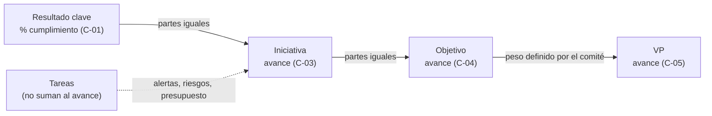
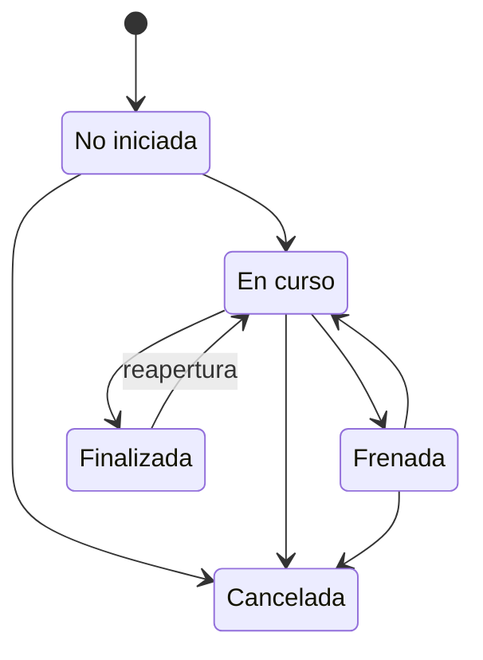
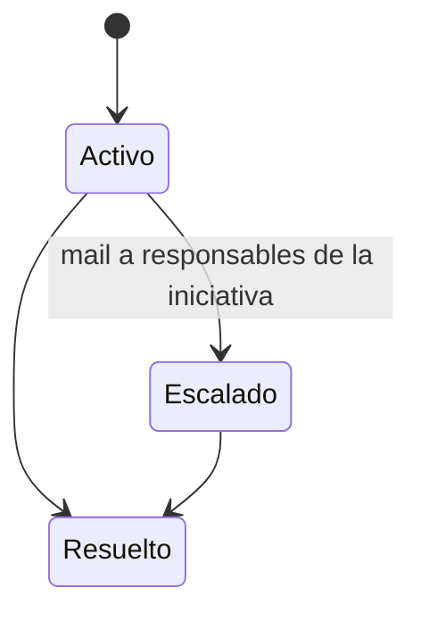
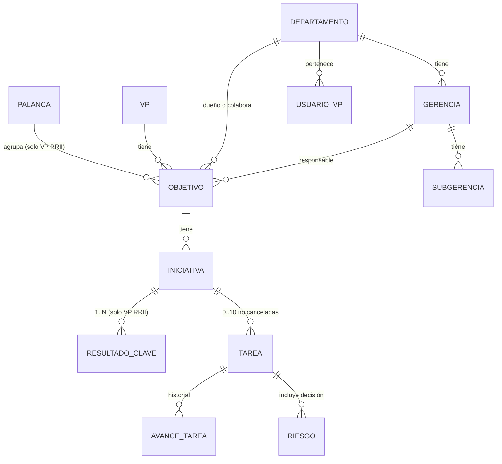

# Especificación funcional · Gestión de Portfolio VP

Aplicación que conecta palancas estratégicas, objetivos, iniciativas, resultados clave y tareas con responsables e indicadores, para traducir la estrategia de la VP en planes medibles y seguir su avance.

| Campo | Valor |
|---|---|
| Proyecto | Gestión de Portfolio VP |
| Cliente | YPF S.A. · VP RRII (Relaciones Institucionales) |
| Documento | Especificación funcional |
| Versión | 1.8 · 06/11/2026 |
| Estado | Versión para diseño y desarrollo |
| Autores | VIGNARDEL, FRANCISCO · PESSINO, MILAGROS |
| Usuarias referentes | BAUMANN, ANALIA · GROTZ, MARIA MARTHA |
| Archivo | Especificacion_Funcional_Gestion_Portfolio_VP_v1.8.docx |

## 1. Introducción

### 1.1 Objetivo de la aplicación

Gestión de Portfolio VP es la plataforma donde la VP RRII baja su estrategia (palancas y objetivos) a iniciativas, resultados clave y tareas, sigue su avance y detecta desvíos a tiempo. Reemplaza el seguimiento mensual en planillas, que reporta el estado sin anticipar los bloqueos que lo explican.

### 1.2 Objetivos específicos

- **Visibilidad ejecutiva.** El VP y los responsables de los departamentos ven cómo vienen los objetivos del año, incluidos los que el VP marca como propios, y bajan de un desvío hasta su causa.
- **Alertas tempranas.** Un riesgo detectado en una tarea llega a los responsables de la iniciativa en el momento en que ocurre.
- **Trazabilidad del esfuerzo.** Queda registrado en qué trabaja la VP, incluido el trabajo que presta a otras VP con sus tareas y su presupuesto.
- **Medición homogénea.** Todos los resultados clave se expresan con el mismo esquema: tipo de medición, unidad, mínimo, meta y máximo.
- **Transparencia.** Toda la VP ve todo lo cargado, para que cada persona sepa en qué se está trabajando.
- **Adopción simple.** La carga es a alto nivel: un título, descripción y comentarios de avance.

### 1.3 Modelo de gestión

La gestión se organiza en una jerarquía de cinco niveles. El avance se calcula desde los resultados clave hacia arriba. Los pesos de los objetivos los define el comité de la VP; los de las iniciativas y los resultados clave se reparten en partes iguales. Las tareas no suman al porcentaje de avance: registran los riesgos que requieren una decisión de los responsables de la iniciativa y su presupuesto se suma al de la iniciativa.

| Nivel | Qué es |
|---|---|
| Palanca estratégica | Prioridad estratégica de la VP que agrupa objetivos con un mismo propósito de negocio. |
| Objetivo | Resultado estratégico que la VP busca alcanzar en el año y que contribuye a una palanca. |
| Iniciativa | Conjunto coordinado de acciones para lograr un objetivo. Es la principal unidad de gestión. |
| Resultado clave | Indicador con el que se mide una iniciativa. |
| Tarea | Acción asignable y acotada en el tiempo que forma parte de una iniciativa. |

*Figura 1. Cómo sube el avance entre niveles*

## 2. Alcance

### 2.1 Incluye

| Módulo | Contenido | Requerimientos |
|---|---|---|
| M1. Palancas | Alta, edición y consulta de las palancas de la VP con sus objetivos. | RF-01 a RF-02 |
| M2. Objetivos | Alta de objetivos de la VP RRII y de otras VP, edición, pesos, marca de objetivo del VP y consulta. | RF-03 a RF-06 |
| M3. Iniciativas y resultados clave | Alta y seguimiento de iniciativas y de sus resultados clave, con pesos calculados en partes iguales. | RF-07 a RF-11 |
| M4. Tareas, riesgos y presupuesto | Alta y seguimiento de tareas, historial de avance, riesgos con decisiones y presupuesto. | RF-12 a RF-15 |
| M5. Bandejas | Bandejas "Mis…" y "Todas" | RF-16 a RF-17 |
| M6. Alertas | Detección de alertas y avisos por mail. | RF-18 |
| M7. Seguridad | Roles de aplicación, permisos y usuarios. | RF-19 a RF-20 |
| M8. Cierre del período | Cierre del período, a definir. | — |
| M9. Maestros y parámetros | Listas administrables y parámetros de alertas. | RF-21 a RF-22 |

### 2.2 Entregas

El desarrollo se divide en entregas para llegar a la carga de los objetivos 2027. La entrega 1 es el 30/11/2026.

| Entrega | Contenido | Para qué |
|---|---|---|
| 1 | M1, M2, M3, M4 y M5, sin el tablero ejecutivo (RF-17) ni el ABM de maestros: departamentos, gerencias y subgerencias se cargan directamente en las listas de SharePoint. | Cargar y presentar los objetivos del año siguiente con sus iniciativas y resultados clave. |
| 2 | M6, M7. | Seguimiento diario de la ejecución desde el inicio del año. |
| 3 | M8, M9 (incluido el ABM de departamentos, gerencias y subgerencias) y tablero ejecutivo de la VP (RF-17). | Vista consolidada para el VP y los responsables de los departamentos. |

### 2.3 No incluye

| Funcionalidad | Motivo |
|---|---|
| Backlog o planificación diaria, microtareas, diagramas de Gantt | La herramienta sigue tareas generales, no gestiona proyectos. |
| Registro de horas y evaluación de personas | No se busca controlar a la gente sino detectar bloqueos. |
| Flujo de aprobaciones | Los objetivos se aprueban en el comité de la VP antes de cargarse; el resto de los niveles no requiere aprobación. |
| Seguimiento detallado de lo que corresponde a otras VP | Lo hace la VP dueña del objetivo. Las iniciativas de objetivos de otras VP se registran con sus tareas y su presupuesto, sin palanca ni resultados clave, para saber cuánta gente de la VP trabaja en objetivos de otras VP (RF-07). |
| Adjuntar archivos de evidencia | La evidencia es un link. |
| Una iniciativa asociada a varios objetivos | Si una iniciativa aporta a dos objetivos, se carga dos veces. |
| Historial de cambios de cada registro | Se evaluará para una etapa posterior. |
| Exportación a PDF | Se evaluará para una etapa posterior. |
| Integraciones con control de gestión, presupuesto o herramientas de planificación | Fuera del alcance de esta versión. |
| Indicadores de eficiencia y rentabilidad | No son el foco de la herramienta. |
| Pesos manuales de iniciativas y resultados clave | En esta versión se reparten en partes iguales (RF-08). Se evaluará después de la primera etapa de uso. |
| Tareas o iniciativas sin vincular | La carga sigue siempre el orden palanca → objetivo → iniciativa → tarea y resultados clave. Un elemento suelto no suma al avance ni aparece en los reportes. |
| Envío de tareas finalizadas a la app de Novedades | Evolutivo a evaluar: un botón en las tareas finalizadas (hitos) para enviarlas como novedad o, como paso intermedio, una descarga en Word. Requiere analizar la integración con esa app. |
| Reportes de carga por persona y por subgerencia | Evolutivo a evaluar: cuántas iniciativas y tareas tiene cada persona y en cuántas iniciativas trabaja cada subgerencia. Los datos necesarios ya se registran. |

## 3. Glosario

| Término | Definición |
|---|---|
| VP RRII | VP de Relaciones Institucionales, dueña de la plataforma. "Otra VP" es cualquier otra vicepresidencia de YPF. |
| Departamento | Unidad de primera línea de la VP RRII (Marketing, Alianzas, Fidelización, etc.). Se divide en gerencias. |
| Gerencia | Subdivisión de un departamento (ej.: B2B, B2C, Growth dentro de Marketing). Es la unidad responsable de un objetivo. |
| Subgerencia (área) | Subdivisión de una gerencia. Indica las áreas que participan de una iniciativa o una tarea. |
| Peso | Porcentaje con el que un elemento contribuye a su nivel superior. Los pesos de los objetivos los define el comité de la VP; los de las iniciativas y los resultados clave se reparten en partes iguales. |
| Mínimo / Meta / Máximo | Umbrales del resultado clave. Ej.: mínimo 10 estaciones, meta 12, máximo 14. |
| Valor actual | Dónde está hoy el resultado clave, con la fuente del dato y un link de evidencia. |
| Valor proyectado | Valor que se espera alcanzar al cierre del año. Que puede cambiar a lo largo del año. |
| % de cumplimiento | Grado de logro de un resultado clave (C-01). |
| Avance | Grado de logro de una iniciativa, un objetivo o la VP (C-03 a C-05). En una tarea, porcentaje de ejecución que declara su responsable. |
| Evidencia | Link a un sitio de SharePoint o Teams, o a un tablero, que respalda el valor actual. |
| Riesgo | Situación que pone en peligro una tarea y que puede requerir una decisión. |
| Decisión pendiente | Decisión que necesita un riesgo para destrabarse. |
| CECO | Centro de costo al que se imputa una inversión. |
| Comité de la VP | Ámbito donde se definen y aprueban los objetivos del año y sus pesos. |
| Objetivo del VP | Objetivo que el VP elige seguir de cerca entre los de todos los departamentos (unos 5) y que comparte en el comité de VPs. |

## 4. Requerimientos funcionales

### 4.1 M1. Palancas estratégicas

#### RF-01 · Alta y edición de palanca

**Descripción**

El administrador carga las palancas de la VP RRII. Son enunciativas: no tienen estado ni avance. Se mantienen durante el año y se replantean al inicio de cada año. El administrador puede cambiar una palanca a inactiva.

**Criterios de aceptación**

- No se puede guardar sin nombre y descripción.
- El nombre y la descripción se pueden editar.
- Una palanca no se elimina: se marca como inactiva. Las palancas inactivas no aparecen al cargar objetivos, pero siguen visibles en los objetivos que ya las usan.
- Las palancas solo existen para la VP RRII.

**Campos de la palanca**

| Campo | Oblig. | Tipo | Regla / observación |
|---|---|---|---|
| ID | Sí | Autonumérico | Asignado por el sistema. |
| Nombre | Sí | Texto |  |
| Descripción | Sí | Texto largo |  |
| Activa | Sí | Sí / No | Por defecto, Sí. |

#### RF-02 · Vista de palancas

**Descripción**

Pantalla de entrada a la estrategia de la VP, que reúne palancas y objetivos en una misma sección. La grilla muestra cada palanca con su descripción y la cantidad de objetivos asociados; al entrar al detalle de una palanca se ve la lista de sus objetivos con su avance (C-04). Desde cada objetivo se navega a su detalle (RF-05).

**Criterios de aceptación**

- Solo muestra palancas activas, salvo que se filtre por año.
- La cantidad de objetivos coincide con los objetivos listados.
- Arriba de la grilla hay dos opciones: Objetivos del VP, que muestra solo los objetivos marcados como del VP (RF-03), y Todos.
- Al navegar palanca → objetivo → iniciativa → tarea, cada vista muestra migas de pan con un link a cada nivel superior y un botón para volver un paso atrás.
- El despliegue de los objetivos dentro de la grilla de palancas, sin entrar al detalle, queda para una entrega posterior.

### 4.2 M2. Objetivos

#### RF-03 · Alta de objetivo

**Descripción**

Un usuario con rol CargadorObjetivo o Administrador carga el objetivo una vez aprobado en el comité, con el peso que el comité le asignó. Lo primero que se elige es la VP: según sea la VP RRII u otra, el formulario muestra campos distintos.

Los objetivos de otra VP se cargan solo para poder asociarles las iniciativas con las que la VP RRII colabora. No llevan palanca, peso, duración ni fechas, y no tienen seguimiento propio. Se indican el departamento y la gerencia de la VP RRII que colaboran.

**Criterios de aceptación**

- El formulario no muestra los campos que no aplican a la VP elegida.
- Al elegir el departamento, el campo Gerencia muestra solo las gerencias de ese departamento. El responsable del objetivo es la gerencia, no una persona.
- El CargadorObjetivo puede asignar el objetivo a cualquier gerencia; el sistema no valida que pertenezca a ella.
- El nombre muestra un ícono de ayuda con la guía de redacción del objetivo.
- No se puede guardar si falta un campo obligatorio; el sistema indica cuáles.
- Las fechas de compromiso no pueden ser anteriores a las de inicio.

**Campos del objetivo**

| Campo | Oblig. | Tipo | Regla / observación |
|---|---|---|---|
| ID | Sí | Autonumérico |  |
| VP | Sí | Lista (maestro VP) | Primer campo del formulario. |
| Departamento | Sí | Lista (maestro Departamentos) | Departamento de la VP RRII dueño del objetivo o, si es de otra VP, el que colabora. |
| Gerencia | Sí | Lista (maestro Gerencias) | Filtrada por el departamento elegido. Gerencia responsable del objetivo o, si es de otra VP, la que colabora. |
| Nombre | Sí | Texto (hasta 255) | Con guía de redacción. |
| Descripción | Sí | Texto largo |  |
| Palanca | Solo VP RRII | Lista (palancas activas) |  |
| Duración | Solo VP RRII | Anual Plurianual Permanente | Plurianual: de 1 a 5 años. Anual: 1 año Permanente: Eterno Un objetivo plurianual o permanente se carga una sola vez; no se vuelve a cargar cada año. |
| Peso en la VP (%) | Solo VP RRII | Número 0–100 | Definido por el comité de la VP. Ver RF-06. |
| Objetivo del VP | Solo VP RRII | Sí / No | Por defecto, No. Marca los objetivos que el VP elige seguir (RF-02, RF-16). |
| Fecha de inicio | Solo VP RRII | Fecha |  |
| Fecha de compromiso | Solo VP RRII | Fecha |  |
| Estado | Sí | No iniciada · En curso · Finalizada | No iniciada al crearse. Se cambia manualmente. |

#### RF-04 · Edición de objetivo

**Descripción**

Una vez guardado, el objetivo solo lo puede modificar el administrador, porque cualquier cambio requiere el visto bueno del VP.

**Criterios de aceptación**

- Para el resto de los roles, todos los campos del objetivo se muestran en modo lectura.
- Un objetivo no se puede eliminar: la aplicación no tiene esa acción.
- El administrador es quien modifica el peso y la marca de objetivo del VP.

#### RF-05 · Vista de objetivo

**Descripción**

Muestra la información del objetivo (nombre, descripción, VP, departamento, gerencia, palanca y si es objetivo del VP), la planificación (duración, peso y fechas), su avance real y proyectado (C-04) con su color (C-07), y la lista de iniciativas con su responsable, estado, avance y peso calculado (RF-08). Desde cada iniciativa se navega a su detalle (RF-11). Las migas de pan muestran su ubicación en la estrategia: palanca → objetivo (RF-02).

**Criterios de aceptación**

- Los resultados clave no se muestran en el objetivo, sino en cada iniciativa.
- Un objetivo de otra VP muestra sus iniciativas, sin avance ni pesos.

#### RF-06 · Pesos de los objetivos

**Descripción**

El peso indica cuánto contribuye cada objetivo de la VP RRII al avance de la VP (C-05). Llega definido por el comité de primera línea de la VP: en la aplicación solo se carga. Lo carga quien da de alta el objetivo y después solo lo modifica el administrador.

**Criterios de aceptación**

- El peso de cada objetivo es sobre el total de objetivos de la VP RRII del año, sin importar el departamento ni la gerencia.
- El sistema no valida que los pesos sumen 100%, porque llegan aprobados por el comité.

### 4.3 M3. Iniciativas y resultados clave

#### RF-07 · Alta de iniciativa

**Descripción**

Cualquier usuario de la VP puede cargar una iniciativa. Toda iniciativa se asocia a un único objetivo existente; no hay iniciativas sin objetivo.

Si el objetivo es de la VP RRII, en el alta se carga al menos un resultado clave (RF-09).

**Criterios de aceptación**

- La lista de objetivos muestra los objetivos cargados, con los del departamento del usuario primero.
- El peso de la iniciativa lo calcula el sistema (RF-08); no se carga.
- Una iniciativa de un objetivo de otra VP lleva su información de identificación (nombre, descripción, responsables, subgerencias, fechas y estado), sus tareas y su presupuesto. No lleva resultados clave ni avance: sirve para saber cuánta gente de la VP trabaja en objetivos de otras VP.
- Las fechas de la iniciativa deben quedar dentro de las del objetivo, si el objetivo las tiene.
- No se puede guardar si falta un campo obligatorio.

**Campos de la iniciativa**

| Campo | Oblig. | Tipo | Regla / observación |
|---|---|---|---|
| ID | Sí | Autonumérico |  |
| Objetivo | Sí | Lista (objetivos cargados) | Uno solo. |
| Nombre | Sí | Texto |  |
| Descripción / impacto esperado | Sí | Texto largo |  |
| Responsables | Sí | Usuarios (uno o más) | Por defecto, quien la carga. Sin límite de cantidad. |
| Subgerencias involucradas | No | Lista múltiple (maestro Subgerencias) | Pueden ser de otro departamento o gerencia que la del objetivo. |
| Peso en el objetivo (%) | — | Calculado | 100% ÷ cantidad de iniciativas no canceladas del objetivo (RF-08). Solo VP RRII. |
| Fecha de inicio | Sí | Fecha |  |
| Fecha de compromiso | Sí | Fecha |  |
| Estado | Sí | No iniciada · En curso · Frenada · Finalizada · Cancelada | No iniciada al crearse. Lo cambia el responsable (RF-11). |
| Comentario ejecutivo | No | Texto largo | Situación de la iniciativa en palabras del responsable. Se guardan la fecha y el autor de la última modificación. |

#### RF-08 · Pesos de las iniciativas y de los resultados clave

**Descripción**

El sistema reparte los pesos en partes iguales: cada iniciativa no cancelada de un objetivo de la VP RRII pesa 100% ÷ la cantidad de iniciativas no canceladas del objetivo, y cada resultado clave pesa 100% ÷ la cantidad de resultados clave de su iniciativa. Por ejemplo, si un objetivo tiene 5 iniciativas, cada una pesa 20%.

En esta versión los pesos de iniciativas y resultados clave no se cargan ni se editan. Se evaluará después de la primera etapa de uso.

**Criterios de aceptación**

- Al agregar o cancelar una iniciativa o un resultado clave, el sistema recalcula el peso de los demás del mismo nivel.
- Los pesos se muestran en modo lectura en el detalle del objetivo y de la iniciativa.

#### RF-09 · Alta de resultados clave

**Descripción**

Cada iniciativa de un objetivo de la VP RRII se mide con uno o más resultados clave, cargados con un esquema homogéneo. Un resultado de hitos se expresa como cantidad.

**Criterios de aceptación**

- El peso de cada resultado clave lo calcula el sistema en partes iguales (RF-08); no se carga.
- Mínimo ≤ Meta ≤ Máximo; si no se cumple, el sistema no deja guardar.
- Al crearse, el valor proyectado toma el valor de la meta.
- No se puede guardar una iniciativa de la VP RRII sin al menos un resultado clave.

**Campos del resultado clave**

| Campo | Oblig. | Tipo | Regla / observación |
|---|---|---|---|
| ID | Sí | Autonumérico |  |
| Iniciativa | Sí | Referencia |  |
| Nombre | Sí | Texto | Ej.: "Implementar YPF Store en 100 estaciones de servicio". |
| Descripción | No | Texto largo |  |
| Responsable | Sí | Usuario (uno) | No se completa por defecto. |
| Tipo de medición | Sí | Cantidad · Porcentaje · Moneda · Indicador |  |
| Unidad de medida | Sí | Texto | Ej.: estaciones, KUSD, puntos. |
| Mínimo | Sí | Número |  |
| Meta | Sí | Número |  |
| Máximo | Sí | Número | Mayor que 0. |
| Peso en la iniciativa (%) | — | Calculado | 100% ÷ cantidad de resultados clave de la iniciativa (RF-08). |
| Valor actual | No | Número | Vacío hasta el primer seguimiento. |
| Fuente | No | Texto | De dónde sale el dato. Vale también para el valor proyectado. |
| Evidencia | No | Link | Un único link. |
| Valor proyectado | Sí | Número | Valor esperado al 31/12. |
| Comentario | No | Texto | Novedad del último seguimiento. Se guardan fecha y autor. |

#### RF-10 · Seguimiento de resultados clave

**Descripción**

Los responsables de la iniciativa o el del resultado clave actualizan el valor actual, la fuente, la evidencia, el valor proyectado y el comentario. El valor es declarativo: no depende de las tareas. El sistema recalcula el cumplimiento y el estado del resultado clave y el avance de la iniciativa, el objetivo y la VP.

**Criterios de aceptación**

- La meta, el mínimo y el máximo no se modifican en el seguimiento.
- Los valores deben ser numéricos.

#### RF-11 · Vista y seguimiento de iniciativa

**Descripción**

Muestra la información de la iniciativa, el objetivo al que aporta, los resultados clave con sus valores, cumplimiento y estado, el avance real y proyectado (C-03), las tareas, los riesgos de sus tareas, el presupuesto total (C-06) y el comentario ejecutivo.

Los responsables actualizan el estado y el comentario ejecutivo. El estado lo administran los responsables y no se deriva del estado de las tareas: una tarea frenada no frena por sí sola la iniciativa. La iniciativa muestra los indicadores que vienen de sus tareas (C-08).

Para que la vista sea simple, por defecto se ven los indicadores de las tareas (C-08) y las tareas asociadas, con el responsable de cada una. El comentario ejecutivo y el resto de la información de detalle se muestran en secciones colapsables que se despliegan a pedido.

**Criterios de aceptación**

- Desde la iniciativa se puede crear una tarea ya asociada a ella.
- Los indicadores de tareas coinciden con las tareas listadas.
- Con estado Finalizada o Cancelada, la iniciativa no admite tareas nuevas hasta que se reabra.
- Una iniciativa de un objetivo de otra VP no muestra resultados clave ni avance.
- Las migas de pan muestran su ubicación: palanca → objetivo → iniciativa (RF-02).

### 4.4 M4. Tareas, riesgos y presupuesto

#### RF-12 · Alta de tarea

**Descripción**

Cualquier usuario de la VP puede cargar una tarea en cualquier iniciativa, de un objetivo de la VP RRII o de otra VP, y asignarla a cualquier persona, incluso de otro departamento (por ejemplo, Fidelización le carga a Publicidad una campaña en vía pública).

**Criterios de aceptación**

- Una iniciativa admite como máximo 10 tareas no canceladas.
- Las fechas de la tarea deben quedar dentro de las de su iniciativa.
- El objetivo se muestra a partir de la iniciativa y no se edita.
- Una tarea siempre pertenece a una iniciativa: no se puede crear una tarea suelta ni vincularla después.
- No se puede guardar si falta un campo obligatorio.

**Campos de la tarea**

| Campo | Oblig. | Tipo | Regla / observación |
|---|---|---|---|
| ID | Sí | Autonumérico |  |
| Iniciativa | Sí | Selección con buscador integrado | Primer campo del formulario. Muestra las iniciativas que no están finalizadas ni canceladas, de objetivos de la VP RRII y de otras VP. |
| Objetivo | — | Calculado | El de la iniciativa. |
| Nombre | Sí | Texto |  |
| Descripción / qué habilita | Sí | Texto largo |  |
| Responsable | Sí | Usuario (uno) |  |
| Subgerencia | Sí | Lista (maestro Subgerencias) | Puede ser distinta de las subgerencias de la iniciativa. |
| Prioridad | No | Alta · Media · Baja |  |
| Fecha de inicio | Sí | Fecha |  |
| Fecha de compromiso | Sí | Fecha | Base de las alertas de vencimiento. |
| Avance (%) | Sí | Número 0–100 | 0 al crearse. |
| Estado | Sí | No iniciada · En curso · Frenada · Finalizada · Cancelada | No iniciada al crearse. |
| Fecha de finalización | Condicional | Fecha | Obligatoria con estado Finalizada; no se muestra con otro estado. |
| Fecha de última actualización | — | Calculado | La registra el sistema en cada actualización de avance. |
| Requiere inversión | Sí | Sí / No | Habilita los campos de RF-15. |

#### RF-13 · Seguimiento de tarea

**Descripción**

El responsable de la tarea, o los de su iniciativa, actualizan el avance y el estado cuando hay novedades. Cada actualización queda en el historial de avance de la tarea con la fecha, el porcentaje, el estado y un comentario opcional (por ejemplo, "el barco llega en 45 días").

Los usuarios con rol Administrador o CargadorObjetivo también pueden crear y modificar tareas.

**Criterios de aceptación**

- Con estado Finalizada, el avance pasa a 100%.
- Una tarea que deja de tener sentido se cancela. Una tarea no se elimina, salvo por el administrador.
- Una tarea Finalizada se puede reabrir a En curso.
- El historial de avance no se edita ni se borra.

**Campos del historial de avance**

| Campo | Oblig. | Tipo | Regla / observación |
|---|---|---|---|
| Fecha | — | Calculado | La registra el sistema. |
| Autor | — | Calculado | Usuario que actualiza. |
| Avance (%) | Sí | Número 0–100 |  |
| Estado | Sí | Estado de la tarea |  |
| Comentario | No | Texto |  |

*Figura 2. Estados de la tarea*

#### RF-14 · Riesgos y decisiones

**Descripción**

Los riesgos se cargan en la tarea, porque es quien ejecuta la que detecta el problema. Una tarea puede tener varios riesgos. Cada riesgo puede requerir una decisión; la decisión se describe en texto (qué se necesita y de quién) y se eleva siempre a los responsables de la iniciativa, que la gestionan.

**Criterios de aceptación**

- Al pasar un riesgo a Escalado, el sistema envía un mail a todos los responsables de la iniciativa (RF-18).
- Los campos de decisión solo se habilitan si el riesgo requiere decisión.
- Una decisión está pendiente mientras el riesgo requiera decisión y no esté Resuelto.
- Los riesgos activos y escalados se ven en la iniciativa y en las bandejas.

**Campos del riesgo**

| Campo | Oblig. | Tipo | Regla / observación |
|---|---|---|---|
| ID | Sí | Autonumérico |  |
| Tarea | Sí | Referencia |  |
| Descripción | Sí | Texto | Ej.: "Aduana retiene el cargamento de pelotas". |
| Estado | Sí | Activo · Escalado · Resuelto | Activo al crearse. |
| Requiere decisión | Sí | Sí / No |  |
| Decisión necesaria | Condicional | Texto | Qué decisión se necesita y de quién (área o persona). |
| Fecha límite de la decisión | Condicional | Fecha |  |
| Fecha de resolución | — | Calculado | La registra el sistema al pasar a Resuelto. |

*Figura 3. Estados del riesgo*

#### RF-15 · Presupuesto de la tarea

**Descripción**

El presupuesto nace en las tareas, donde se desglosa la acción (medios, imagen, proveedores, importación). Si la tarea requiere inversión, se cargan el CECO y el presupuesto aprobado; durante el seguimiento, el presupuesto ejecutado. La iniciativa muestra la suma de sus tareas (C-06), y como cada tarea tiene su CECO, una iniciativa puede imputar a varios. La iniciativa muestra el total sumado, sin desglose por CECO; el CECO se consulta en cada tarea.

**Criterios de aceptación**

- Los campos de presupuesto solo se habilitan con Requiere inversión = Sí.
- El presupuesto lo ve cualquier usuario que ve la tarea.

**Campos de presupuesto de la tarea**

| Campo | Oblig. | Tipo | Regla / observación |
|---|---|---|---|
| CECO | Condicional | Texto |  |
| Presupuesto aprobado | Condicional | Moneda |  |
| Presupuesto ejecutado | No | Moneda | Se actualiza en el seguimiento. |
| Saldo | — | Calculado | C-06. |

### 4.5 M5. Bandejas y tablero

#### RF-16 · Bandejas

**Descripción**

Cada usuario tiene bandejas de trabajo: "Mis tareas" (de las que es responsable), "Mis iniciativas" (de las que es responsable) y "Todas". Por defecto muestran lo de su departamento; con filtros se ve el resto de la VP. "Mis tareas" agrupa las tareas por estado y destaca las vencidas, las próximas a vencer, los riesgos activos y las decisiones pendientes.

**Criterios de aceptación**

- Los contadores coinciden con los listados.
- En la sección de palancas y objetivos se puede elegir entre Objetivos del VP y Todos (RF-02).
- Los filtros disponibles son departamento, gerencia, objetivo, objetivo del VP, iniciativa, responsable, estado y año.

#### RF-17 · Tablero ejecutivo de la VP

**Descripción**

Vista consolidada para el VP y los responsables de los departamentos, pensada también para un monitor del piso: avance global de la VP (C-05), objetivos por palanca con su avance y color, riesgos escalados, decisiones pendientes y elementos sin actualizar. Desde cada objetivo se baja a sus iniciativas y de cada iniciativa a la tarea o el riesgo que explica el desvío.

**Criterios de aceptación**

- Se construye en la entrega 3, una vez estable la carga.
- Permite ver solo los objetivos del VP.
- Puede resolverse dentro de la aplicación o como un tablero aparte sobre las mismas listas; se define en el diseño técnico.

### 4.6 M6. Alertas

#### RF-18 · Alertas

**Descripción**

El sistema detecta las alertas a partir de las tareas y los riesgos. Todas se muestran en la iniciativa, en las bandejas y en el tablero; el riesgo escalado además se avisa por mail.

**Criterios de aceptación**

- Los plazos son parámetros (RF-22).

| Alerta | Se dispara cuando | Dónde se ve |
|---|---|---|
| Riesgo escalado | Un riesgo pasa a Escalado. | Mail a los responsables de la iniciativa · iniciativa · bandejas · tablero |
| Tarea vencida | La fecha de compromiso es anterior a hoy y la tarea no está Finalizada ni Cancelada. | Iniciativa · bandejas · tablero |
| Próxima a vencer | La fecha de compromiso cae dentro de los próximos N días (parámetro) y la tarea no está Finalizada ni Cancelada. | Iniciativa · bandejas |
| Tarea sin actualizar | Pasaron más de 15 días (parámetro) desde la última actualización de una tarea No iniciada, En curso o Frenada. | Iniciativa · bandejas · tablero |
| Decisión pendiente | Un riesgo requiere decisión y no está Resuelto. | Iniciativa · bandejas · tablero |

### 4.7 M7. Seguridad

#### RF-19 · Roles y permisos

**Descripción**

Los permisos dependen del rol en la aplicación, que es independiente del puesto. Cada persona tiene un único rol. Toda la VP ve toda la información cargada: la restricción está en la carga y la edición, no en la visualización. La información confidencial no se carga en la plataforma.

Los roles se implementan como grupos que el administrador mantiene.

**Criterios de aceptación**

- Si el usuario no tiene el rol adecuado para una acción, no se le muestran los botones Editar ni Guardar; además, el sistema rechaza el guardado.

| Rol | Quiénes | Qué puede hacer |
|---|---|---|
| Visualizador | El VP | Consulta todo. No carga ni edita. |
| Usuario | Toda la VP | Crea iniciativas, resultados clave y tareas. Edita las iniciativas de las que es responsable con sus resultados clave y tareas, y las tareas de las que es responsable. |
| CargadorObjetivo | Gerentes y responsables de departamento designados | Lo del Usuario, más: crea objetivos para cualquier gerencia y edita las iniciativas, resultados clave y tareas (por ejemplo, si el responsable está ausente). |
| Administrador | Coordinación de la VP y referentes designados | Todo lo anterior, más: palancas, edición de objetivos, sus pesos y la marca de objetivo del VP, maestros, parámetros, asignación de roles y eliminación de tareas. |

| Acción | Visualizador | Usuario | CargadorObjetivo | Admin. |
|---|---|---|---|---|
| Ver toda la información | Sí | Sí | Sí | Sí |
| Crear y editar palancas | — | — | — | Sí |
| Crear objetivos | — | — | Sí | Sí |
| Editar objetivos y sus pesos | — | — | — | Sí |
| Crear iniciativas, resultados clave y tareas | — | Sí | Sí | Sí |
| Editar iniciativa y resultados clave | — | Si es responsable | Sí | Sí |
| Actualizar valores de resultados clave | — | Resp. de la iniciativa o del resultado clave | Sí | Sí |
| Actualizar tarea, riesgos y presupuesto | — | Resp. de la tarea o de la iniciativa | Sí | Sí |
| Maestros, parámetros, roles y eliminar tareas | — | — | — | Sí |

#### RF-20 · Usuarios

**Descripción**

Las personas se toman del directorio corporativo; no hay alta de usuarios en la aplicación. El administrador mantiene la lista de usuarios de la VP con su departamento, gerencia y subgerencia, que se usa en los filtros y en las bandejas.

**Criterios de aceptación**

- Cuando una persona deja la VP se reasigna sus elementos abiertos. Los elementos cerrados conservan al responsable original.
- Las personas inactivas no aparecen en los campos de usuario.

**Campos del usuario de la VP**

| Campo | Oblig. | Tipo | Regla / observación |
|---|---|---|---|
| Persona | Sí | Usuario del directorio |  |
| Departamento | Sí | Lista (maestro Departamentos) |  |
| Gerencia | No | Lista (maestro Gerencias) | Filtrada por el departamento. Solo para departamentos con gerencias. |
| Subgerencia | No | Lista (maestro Subgerencias) | Filtrada por la gerencia. |

### 4.8 M8. Cierre del período

Este módulo entra en la tercera entrega. Su lógica se define más adelante.

### 4.9 M9. Maestros y parámetros

#### RF-21 · Maestros

**Descripción**

El administrador mantiene las listas que usan los formularios.

**Criterios de aceptación**

- Un valor de un maestro no se elimina: se desactiva, y deja de ofrecerse en los formularios.
- En la entrega 1 no hay ABM de departamentos, gerencias ni subgerencias: se cargan directamente en las listas de SharePoint.

| Maestro | Contenido inicial |
|---|---|
| VP | VP RRII y las demás VP de YPF. |
| Departamentos (VP RRII) | VP, Coordinación, Alianzas, Apoyo a la Operación, Fidelización, Medios y Prensa, Marketing, YDI. |
| Gerencias | Por departamento. En Marketing: B2B, B2C, Dirección, Growth, IEC y Servicios. |
| Subgerencias (áreas) | Por gerencia, a relevar. Incluye las áreas que participan de iniciativas y tareas (ej.: Legales, Compras, Imagen, Publicidad). |
| Palancas | Excelencia comercial, Experiencia de cliente, Nuevos negocios, Marca y portfolio (RF-01). |

#### RF-22 · Parámetros

**Descripción**

Valores que el administrador puede cambiar sin modificar la aplicación.

| Parámetro | Valor inicial |
|---|---|
| Días sin actualización para alertar | 15 |
| Días de anticipación para "próxima a vencer" | 7 |
| Máximo de tareas por iniciativa | 10 |
| Umbrales de color de avance (C-07) | 60% · 80% · 100% |

## 5. Cálculos

Todos los cálculos se hacen por separado con el valor actual (real) y con el valor proyectado. Los porcentajes se expresan entre 0% y 100%, salvo el % de cumplimiento del resultado clave, que puede superar 100% para mostrar sobrecumplimiento.

| Código | Cálculo | Fórmula y reglas |
|---|---|---|
| C-01 | % de cumplimiento del resultado clave | Real = valor actual ÷ máximo. Proyectado = valor proyectado ÷ máximo. Sin valor actual, el cumplimiento real es 0%. |
| C-02 | Estado del resultado clave | Se calcula con el valor actual (estado real) y con el proyectado (estado proyectado): • valor < mínimo → No cumple (rojo) • mínimo ≤ valor < meta → Mínimo (naranja) • meta ≤ valor < máximo → Meta (amarillo) • valor ≥ máximo → Máximo (verde) |
| C-03 | Avance de la iniciativa | Avance = promedio simple de mín(% cumplimiento, 100%) de sus resultados clave, porque pesan en partes iguales (RF-08). El avance de las tareas no interviene. |
| C-04 | Avance del objetivo | Avance = promedio simple del avance de sus iniciativas, porque pesan en partes iguales (RF-08). Solo cuentan las iniciativas no canceladas. No se calcula para objetivos de otra VP. |
| C-05 | Avance de la VP | Avance = Σ (peso del objetivo × avance del objetivo) ÷ Σ pesos de los objetivos de la VP RRII del año. |
| C-06 | Presupuesto | Saldo de la tarea = presupuesto aprobado − presupuesto ejecutado. Presupuesto de la iniciativa (aprobado, ejecutado y saldo) = suma de los de sus tareas no canceladas, también en iniciativas de otras VP. |
| C-07 | Color del avance | Se aplica al avance de iniciativas, objetivos y VP: • menos de 60% → rojo • de 60% a menos de 80% → amarillo • 80% o más → verde Los umbrales son parámetros (RF-22). |
| C-08 | Indicadores de tareas en la iniciativa | Cantidad de tareas por estado, tareas vencidas, próximas a vencer y sin actualizar (RF-18), riesgos activos y escalados, y decisiones pendientes. |

Ejemplo. Una iniciativa tiene dos resultados clave: "Implementar YPF Store en 100 estaciones" (máximo 100, valor actual 40 → 40%) y "Alcanzar USD 193 K de facturación" (máximo 210, valor actual 230 → 110%, que suma como 100%). Cada uno pesa 50%, así que el avance de la iniciativa = (40% + 100%) ÷ 2 = 70% (amarillo). Si el objetivo tiene tres iniciativas, cada una pesa 1/3; si las otras dos tienen 90% y 60%, el avance del objetivo es (70% + 90% + 60%) ÷ 3 = 73,3%.

## 6. Modelo de datos

Cada entidad corresponde a una lista. Los campos de cada una están en su requerimiento.

*Figura 4. Entidades y relaciones*

| Entidad | Campos en | Relaciones |
|---|---|---|
| Palanca | RF-01 | Una palanca agrupa 0..N objetivos de la VP RRII. |
| Objetivo | RF-03 | Pertenece a una VP, un departamento, una gerencia y, si es de la VP RRII, a una palanca. Tiene 0..N iniciativas. |
| Iniciativa | RF-07 | Pertenece a un único objetivo. Tiene hasta 10 tareas no canceladas. Si el objetivo es de la VP RRII, tiene además 1..N resultados clave. |
| Resultado clave | RF-09 | Pertenece a una iniciativa. |
| Tarea | RF-12, RF-15 | Pertenece a una iniciativa. Tiene 0..N registros de avance y 0..N riesgos. |
| Avance de tarea | RF-13 | Pertenece a una tarea. Solo se agregan registros. |
| Riesgo | RF-14 | Pertenece a una tarea. Incluye su decisión. |
| Usuario de la VP | RF-20 | Persona del directorio con su departamento, gerencia y subgerencia. |
| VP, Departamento, Gerencia, Subgerencia | RF-21 | Maestros. Un departamento tiene 0..N gerencias y una gerencia, 0..N subgerencias. |
| Parámetro | RF-22 | Clave y valor. |

## 7. Requerimientos no funcionales

| ID | Tema | Requerimiento |
|---|---|---|
| RNF-01 | Plataforma | Aplicación SharePoint Framework (SPFx) con React, sobre listas de SharePoint Online, desarrollada desde cero. |
| RNF-02 | Autenticación | Cuentas corporativas de YPF, con inicio de sesión único. No hay usuarios propios de la aplicación. |
| RNF-03 | Autorización | Roles como grupos de SharePoint (RF-19). Los permisos de las listas acompañan a los de la interfaz: lectura para toda la VP y escritura controlada, para que la seguridad no dependa solo de la pantalla. |
| RNF-04 | Volumen | Unas 100 personas. Volumen anual estimado para toda la VP: hasta 50 objetivos, 150 iniciativas, 300 resultados clave y 1.000 tareas. Las listas se indexan por año, objetivo, iniciativa y responsable para no superar el umbral de vista de SharePoint. |
| RNF-05 | Rendimiento | Las vistas y bandejas cargan en menos de 3 segundos con el volumen de un año. |
| RNF-06 | Usabilidad | Formularios cortos, con campos condicionales y ayudas en línea. Actualizar una tarea lleva menos de un minuto. |
| RNF-07 | Idioma y formatos | Español. Fechas dd/mm/aaaa. Números con separador de miles y coma decimal. |
| RNF-08 | Notificaciones | Mails desde una cuenta de servicio, con un link directo al elemento. |
| RNF-09 | Trazabilidad | Fecha y autor de creación y última modificación en todas las listas; historial de avance de tareas. |
