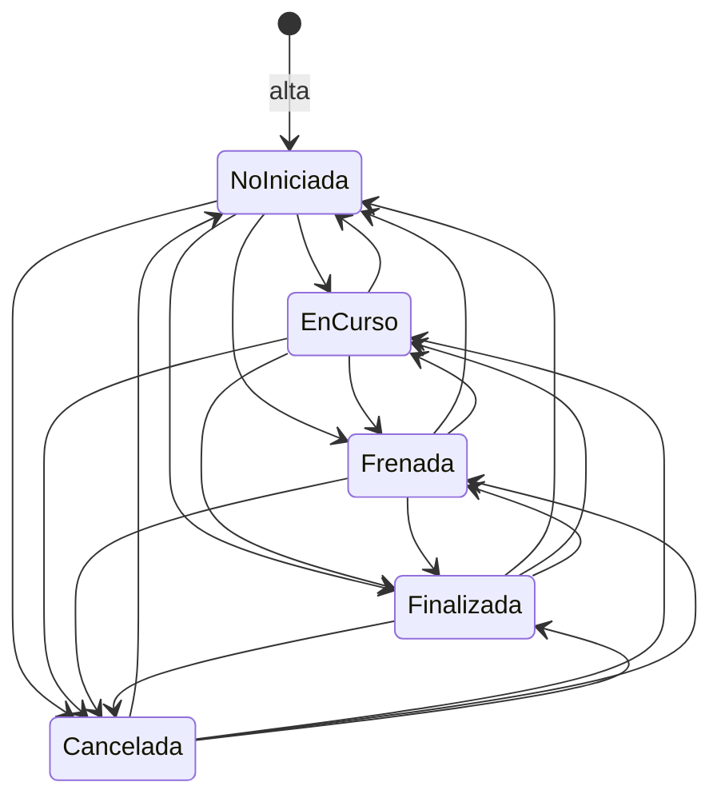

# Data Model: Iniciativas

Usa listas que ya existen (spec, Assumptions). Los nombres internos son los que ya usan los datasources de `core/api`. No se crean listas ni columnas. La única columna que cambió es `Area` de la lista `Iniciativa`, que la usuaria ya pasó a valores múltiples (research, U4).

## Iniciativa (`Lista.Iniciativa` = "Iniciativa")

| Atributo (entidad) | Columna (interna) | Tipo | Obligatorio | Regla |
|---|---|---|---|---|
| `Id` | `Id` | autonumérico | sistema | Se muestra como `INI-<Id con dos dígitos>` (D9). No se edita (FR-002). |
| `Titulo` | `Title` | texto | sistema | Se escribe igual que `Nombre` al crear y al editar (FR-009). |
| `Nombre` | `Nombre` | texto, hasta 255 | sí | Se guarda sin espacios al inicio y al final. Solo espacios = vacío. |
| `Descripcion` | `Descripcion` | texto largo | sí | Ídem. Se muestra como "Descripción / impacto esperado". |
| `Objetivo` | `Objetivo` (lookup a `Objetivo`) | lookup, un valor | sí | No cambia después del alta (FR-024). |
| `Accountable` | `Accountable` (persona, **una sola**; columna nueva, plan P2) | persona | sí, una | Por defecto, quien carga la iniciativa. Reemplaza a la columna `Responsables`, que la usuaria borra después de verificar. |
| `Area` | `Area` (lookup a `Area`, **varios**) | lookups | no | Se muestra como "Áreas involucradas". Cambia de `ILookupValue` a `ILookupValue[]` (D3). |
| `Estado` | `Estado` (opción) | `EstadoIniciativa` | sí | "No iniciada" al crear (FR-005). Cualquier estado pasa a cualquier otro (FR-006). |
| `FechaInicio` | `FechaInicio` | fecha | sí | No anterior a la del objetivo, si la tiene (FR-004). |
| `FechaCompromiso` | `FechaCompromiso` | fecha | sí | No anterior a `FechaInicio`; no posterior a la del objetivo, si la tiene (FR-004). |
| `Peso` | `Peso` | número | — | **No se usa** (spec, Assumptions). La entidad no cambia: lo lee y, si vino con valor, lo reescribe igual. |
| `Created`, `Author`, `Modified`, `Editor` | — | sistema | — | Sin uso en esta feature. |

### Valores calculados (no se guardan)

| Valor | Regla | Se muestra en |
|---|---|---|
| Peso en el objetivo | Si el objetivo es de la VP RRII y la iniciativa no está cancelada: `100 ÷ n`, con `n` = iniciativas no canceladas del objetivo. Si no, sin valor (FR-013). | Detalle de la iniciativa y grilla de iniciativas del detalle del objetivo. |
| Peso en el departamento | Mismas condiciones. `Objetivo.Peso ÷ n` (algebraicamente igual a `(100 ÷ n) × Objetivo.Peso ÷ 100`, sin redondeo intermedio). Si el objetivo no tiene `Peso`, "—" (FR-014a, FR-014b). | Detalle de la iniciativa. |
| Pertenece a "Mis iniciativas" | `Accountable.Id` es igual al Id de usuario del sitio del usuario actual. Nunca se compara por nombre (plan, D5a). | Bandeja. |
| Años de la iniciativa | Todos los años entre `FechaInicio.getFullYear()` y `FechaCompromiso.getFullYear()`, incluidos (FR-020). | Filtro Año. |

Los dos pesos se redondean solo al mostrarlos (D12).

## ComentarioIniciativa (`Lista.ComentarioIniciativa` = "Comentario iniciativa")

| Atributo | Columna | Tipo | Regla |
|---|---|---|---|
| `Iniciativa` | `Iniciativa` (lookup) | lookup | Iniciativa a la que pertenece. |
| `Comentario` | `Comentario` | texto largo | Texto del comentario ejecutivo. |
| `Created` | `Created` | fecha | Fecha que se muestra. |
| `Author` | `Author` | persona | Autor que se muestra. |

- Cada cambio del comentario crea un elemento nuevo (FR-030). Nunca se editan ni se eliminan.
- El "último comentario" de una iniciativa es el de mayor `Created`; ante igualdad, el de mayor `Id`.
- Se leen solo los de la iniciativa que se ve, filtrando `IniciativaId` en la consulta (plan, D24). El datasource suma `getFilteredItems(iniciativaId)`; la entidad no cambia.
- **Índice requerido**: la columna `Iniciativa` de esta lista tiene que estar indexada (plan, P1).

## Area (`Lista.Area` = "Area")

Maestro de áreas: `Nombre` y `Gerencia`. Se ofrecen todas (FR-011), ordenadas por `Nombre`. Sin cambios en la entidad ni en el datasource.

## Usuario (`Lista.Usuario` = "Usuario")

| Atributo | Uso |
|---|---|
| `Usuario` (persona: `Id`, `Title`, `EMail`) | Opción del campo Accountable: clave `Id` (identificador único del usuario en el sitio), nombre `Title` (solo para mostrar). |
| `Activo` | Solo se ofrecen los activos, más el accountable actual de la iniciativa que se edita y el usuario actual (D7). |

El datasource suma `getCurrentUser()` (D5). La entidad no cambia.

## Objetivo (sin cambios)

Lo que usa esta feature: `Id`, `Nombre`, `VP` (decide si hay pesos, con `isVpRrii`), `Departamento` (filtro de la bandeja), `Palanca` (migas), `Peso` (peso en el departamento, feature 005), `FechaInicio` y `FechaCompromiso` (acotan las fechas de la iniciativa, si existen).

## Estados de la iniciativa

Cualquier transición es manual y solo desde "Cambiar estado": el panel de edición no muestra el Estado (plan, D26). Pasar a Cancelada o salir de ella cambia `n` y, por lo tanto, los pesos de las demás iniciativas del objetivo.

## Validaciones del panel de cargar y editar

| Campo | Regla | Mensaje |
|---|---|---|
| Objetivo, Nombre, Descripción, Accountable (una persona), Fecha de inicio, Fecha de compromiso | Obligatorios; texto recortado | `RequiredField` "Este campo es obligatorio." |
| Fecha de compromiso | No anterior a la de inicio | `ObjetivoDateOrder` (se reutiliza) |
| Fecha de inicio | No anterior a la del objetivo, si la tiene | `IniciativaDateOutOfRange` |
| Fecha de compromiso | No posterior a la del objetivo, si la tiene | `IniciativaDateOutOfRange` |

Las fechas se comparan como texto `AAAA-MM-DD`, sin aritmética.
