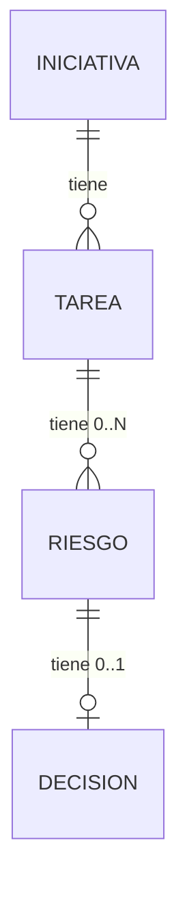
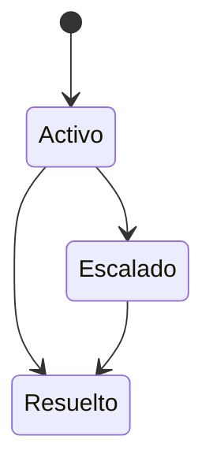

# Data Model: Riesgos y decisiones

Usa listas que ya existen (`Riesgo` y `Decision`). Los nombres internos son los que usan los datasources de `core/api`. El código no crea ni modifica listas ni columnas: lo que depende del sitio son las [verificaciones a cargo de la usuaria](./plan.md#verificaciones-a-cargo-de-la-usuaria). También se leen `Tarea` e `Iniciativa`, sin cambios.

## Riesgo (`Lista.Riesgo` = "Riesgo")

| Atributo (entidad) | Columna (interna) | Tipo | Obligatorio | Regla |
|---|---|---|---|---|
| `Id` | `Id` | autonumérico | sistema | Se muestra como `RSK-<Id con dos dígitos>` (`formatRiesgoId`). No se edita (FR-001). |
| `Titulo` | `Title` | texto, hasta 255 | sistema | La descripción recortada a 255 caracteres; la completa la escribe el servicio al crear y al editar (D2). Nunca se muestra. |
| `Descripcion` | `Descripcion` | varias líneas, texto sin formato | sí | La descripción completa (FR-002). Es lo que muestra la grilla. |
| `Tarea` | `Tarea` (lookup a `Tarea`) | un valor | sí | Se toma del contexto y no cambia (FR-001). Indexada (V4). |
| `Estado` | `Estado` (opción) | `EstadoRiesgo` | sí | Activo · Escalado · Resuelto. Activo al crear (FR-003). Transiciones de FR-004 y FR-009. Valores exactos: V1. |
| `RequiereDecision` | `RequiereDecision` (sí/no) | booleano | sí | Por defecto No (FR-002). De Sí a No no se permite si hay decisión guardada (FR-010); de No a Sí sí. |
| `FechaResolucion` | `FechaResolucion` | fecha (o fecha y hora, V5) | no | La escribe el servicio al pasar a Resuelto, con la fecha del guardado; no se sobrescribe ni se muestra (FR-005, FR-014). |
| `Created`, `Modified` | — | sistema | — | Fecha de creación y de última modificación (FR-006). |
| `Author`, `Editor` | — | sistema | — | Autor de creación y de última modificación (FR-006). |

## Decisión (`Lista.Decision` = "Decision")

| Atributo (entidad) | Columna (interna) | Tipo | Obligatorio | Regla |
|---|---|---|---|---|
| `Id` | `Id` | autonumérico | sistema | No se muestra. |
| `Titulo` | `Title` | texto, hasta 255 | sistema | `DecisionNecesaria` recortada a 255, escrita por el servicio (D2). Nunca se muestra. |
| `DecisionNecesaria` | `DecisionNecesaria` | varias líneas, texto sin formato | sí | Qué decisión se necesita y de quién, en un solo texto libre (FR-008, FR-015). |
| `Riesgo` | `Riesgo` (lookup a `Riesgo`) | un valor | sí | Un riesgo tiene como máximo una decisión: el servicio consulta antes de agregar (D3). Indexada (V4). |
| `FechaLimite` | `FechaLimite` | fecha (V5) | sí | No anterior a hoy al cargarla o modificarla; igual a la guardada se acepta (FR-010a). Sin relación con las fechas de la tarea. |
| `Created`, `Modified`, `Author`, `Editor` | — | sistema | — | Fecha y autor de creación y de última modificación de la decisión (FR-008). |
| ~~`Responsable`~~ | `Responsable` | — | — | **No se usa** (FR-015): la entidad deja de mapearla y de enviarla; el `select` deja de pedirla (D1). V2: que no sea obligatoria. |
| ~~`FechaResolucion`~~ | `FechaResolucion` | — | — | **No se usa** (FR-016): la decisión no tiene fecha de resolución propia (D1). V2: que no sea obligatoria. |

## Relaciones

- Un riesgo pertenece a una tarea (que no cambia) y tiene a lo sumo una decisión, que solo existe si `RequiereDecision` es Sí.
- La decisión se eleva siempre al accountable de la iniciativa de la tarea: no hay campo de destinatario; el "de quién" va dentro de `DecisionNecesaria` (FR-008, FR-015).
- Una decisión está **pendiente** mientras su riesgo requiera decisión y no esté Resuelto (FR-008a, FR-016): se calcula, no se guarda.
- Los riesgos y las decisiones no se eliminan desde la aplicación (FR-007). El borrado solo lo usa el servicio para deshacer un registro creado en ese mismo guardado (D4).

## Estados del riesgo

| Estado actual | Estados que ofrece la edición | ¿Editable? | Efecto |
|---|---|---|---|
| Activo | Activo, Escalado, Resuelto | Sí (salvo tarea Cancelada) | — |
| Escalado | Escalado, Resuelto | Sí (salvo tarea Cancelada) | Cambio de estado a Escalado: mensaje «El riesgo "[descripción]" se ha escalado correctamente.»; el mail es de otra feature. |
| Resuelto | — (ninguno) | **No** (solo lectura, con su decisión) | Registra `FechaResolucion` al entrar; no cambia después. |
| (no se pudo leer) | — | No (falla cerrado) | — |

Escalado → Activo y cualquier salida de Resuelto se rechazan en el servicio (FR-009).

### Qué permite cada combinación de cierre

| Tarea | Iniciativa | "Cargar riesgo" | Editar riesgos Activo y Escalado | Editar Resueltos | Lista y contadores de la iniciativa |
|---|---|---|---|---|---|
| No Finalizada ni Cancelada | No Finalizada ni Cancelada | Sí | Sí | No | Sí |
| Finalizada | cualquiera | No | Sí | No | Sí |
| Cancelada | cualquiera | No | **No** (solo lectura) | No | **No** (se ven en el detalle de la tarea) |
| cualquiera | Finalizada o Cancelada | No | Sí (si la tarea no está Cancelada) | No | Sí (si la tarea no está Cancelada) |

## Quién escribe cada campo

| Campo | Alta | Edición | Reversión |
|---|---|---|---|
| `Riesgo.Title` | `recortarTitulo(Descripcion)` | Igual, si cambió la descripción | Valor anterior |
| `Riesgo.Descripcion` | Valor ingresado | Si cambió | Valor anterior |
| `Riesgo.Tarea` | Tarea del contexto | No se envía | — |
| `Riesgo.Estado` | Activo | El elegido (validado) | Valor anterior |
| `Riesgo.RequiereDecision` | Valor elegido (No por defecto) | Solo de No a Sí | Valor anterior |
| `Riesgo.FechaResolucion` | No se envía | Fecha del guardado, solo al pasar a Resuelto | `null` si la había escrito este guardado |
| `Decision.Title` | `recortarTitulo(DecisionNecesaria)` | Igual, si cambió | Valor anterior |
| `Decision.DecisionNecesaria` | Valor ingresado | Si cambió | Valor anterior |
| `Decision.Riesgo` | El riesgo recién creado | El riesgo en edición, solo al crear | — |
| `Decision.FechaLimite` | Valor ingresado | Si cambió | Valor anterior |
| `Responsable`, `Decision.FechaResolucion` | **No se escriben nunca** | — | — |

La edición escribe **solo lo que cambió**: si la decisión no cambia, su `Modified` y `Editor` no se tocan (Story 3 §8).

## Lecturas

| Pantalla | Consulta | Filtro | Resultado |
|---|---|---|---|
| Detalle de la tarea | Riesgos de la tarea | `TareaId eq n` (todos los estados) | `Riesgo[]` |
| Detalle de la tarea | Decisiones de esos riesgos | `RiesgoId eq a or RiesgoId eq b …`, solo de los que requieren decisión, en tandas de 40 | `Decision[]` |
| Detalle de la iniciativa | Riesgos activos y escalados | `(TareaId eq a or … hasta 10) and Estado ne 'Resuelto'`, con las tareas no Canceladas | `Riesgo[]` |
| Detalle de la iniciativa | Decisiones de esos riesgos | Igual que arriba, solo los que requieren decisión | `Decision[]` |
| Ambas | Orden de las filas | En memoria: Escalado, Activo y Resuelto, y por ID ascendente dentro de cada grupo (`ordenarRiesgos`); no se resuelve en la consulta | — |
| Servicio (validación del alta) | `getById` de tarea e iniciativa | — | Lo vigente en la lista |
| Servicio (validación de la edición) | `getById` de riesgo y de tarea; decisiones del riesgo (la iniciativa no se lee) | `RiesgoId eq n` | Lo vigente en la lista |

